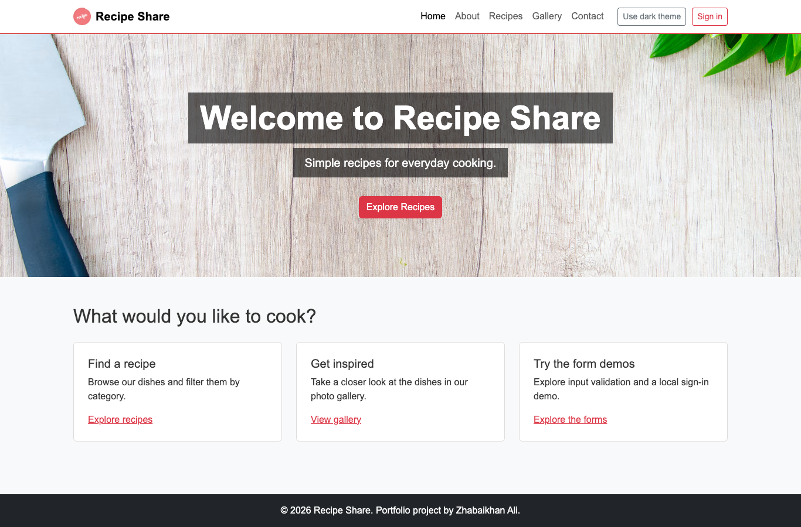
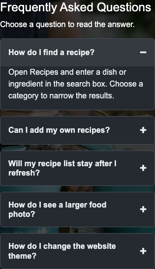

# Recipe Share

A responsive recipe website and front-end portfolio project maintained by Zhabaikhan Ali. Browse dishes, search live recipe data, and explore interactive layouts and forms.

[Live demo](https://alismood.github.io/Web-dev-midterm/) · [Source code](https://github.com/alismood/Web-dev-midterm)

## Features

- Case-insensitive recipe search and category filters.
- Live recipe search with TheMealDB, including loading, empty, and error states.
- A recipe list with add, edit, delete, and confirmation controls.
- A photo lightbox with previous and next controls, keyboard navigation, and fade effects.
- Light and dark themes saved across pages and refreshes.
- Expandable FAQ answers with keyboard-accessible buttons.
- Form validation, password strength feedback, and a local sign-in demo.

## Built With

HTML, CSS, Bootstrap, JavaScript, and jQuery. The layouts use Flexbox, CSS Grid, and media queries, while API requests use fetch() and JSON.

## Project Structure

The five HTML files contain Home, About, Recipes, Gallery, and Forms pages. Shared styles are in css/style.css, interactive features are in js/script.js, and bundled libraries are in vendor.

## Run Locally

Clone or download this repository and open the folder in VS Code. Start Live Server and open index.html through the local server so browser storage works consistently across pages.

## Implementation

The theme and local sign-in state use localStorage, and the FAQ and gallery use jQuery events and effects. Recipe data is rendered into cards with text-safe DOM updates, and failed API requests show a retry message.

<<<<<<< HEAD

=======
## Demo Limits
>>>>>>> db40fc4 (init)

Sign-in stores a name and email on this browser and does not authenticate a real account. Contact and registration validate input without sending messages or creating accounts, and the recipe list resets on page reload.

Online recipes and remote photos need an internet connection. Clear the saved sign-in details using Sign out; the theme setting stays saved separately.

## Mobile Preview

The layout adapts to narrow screens, including the navigation, recipe cards, and forms. Both themes use the same responsive structure.

## Credits

<<<<<<< HEAD

## Recipe List

Users can add, view, edit, and delete recipes in a table. A confirmation appears before deleting, and the list resets when the page reloads.

## Gallery

The gallery uses CSS Grid to display food photos. Clicking a photo opens a larger view with previous and next buttons and fade effects.

## Contact and Registration

The forms check required fields, email format, password length, and matching passwords. The password strength label changes between weak, medium, and strong as the user types. These practice forms show feedback without creating accounts or sending messages.

## Theme

The theme button switches every page between light and dark colors. The choice is saved in localStorage and stays after refreshing or opening another page.

## Sign In

The sign-in form checks the name and email, then saves them in localStorage on this browser. A welcome message and sign-out button appear on every page, and signing out removes the saved user details. This is a local demo and does not check account passwords.

## Layout

Recipe cards use Flexbox, and the gallery uses CSS Grid. Bootstrap columns and media queries adjust the pages for small screens.

## Technologies

The website uses HTML, CSS, Bootstrap, JavaScript, and jQuery. The code uses basic variables, arrays, loops, functions, events, and page updates.

## Files

The five HTML files contain the pages, and css/style.css contains the styles. The interactive features are in js/script.js, and the Bootstrap and jQuery libraries are in vendor.

## Run

Open the website with a local web server, such as VS Code Live Server, so saved details work across pages. Bootstrap and jQuery are included locally, but the food photos need an internet connection.

## Responsibilities

This is a proposed split of the final work. Confirm that it matches each member's actual contribution before submitting.

### Zhabaikhan Ali

Earlier work covered the Home and About pages. Final responsibilities are the saved light and dark themes, the FAQ, and their documentation.

### Abdul Mobin

Earlier work covered the Recipes and Gallery pages. Final responsibilities are the recipe API, result cards, request messages, and their documentation.

### Diyar Kabyken

Earlier work covered the Contact page. Final responsibilities are sign-in validation, saved user details, sign-out, and their documentation.

## Report

Recipe Share Report.docx contains the group defense guide. It lists assigned features, demo steps, code to study, and practice questions for each member.

## Links

Website: https://alismood.github.io/Web-dev-midterm/

Repository: https://github.com/alismood/Web-dev-midterm

## Development Support

AI tools supported development, testing, and troubleshooting
=======
Recipe data comes from [TheMealDB](https://www.themealdb.com/docs_api_guide.php), and food photos are hosted on Unsplash. Bootstrap and jQuery retain their original license notices in vendor.

## Development Support

AI tools supported development, testing, and troubleshooting. The project demonstrates browser storage, API requests, DOM updates, accessible controls, and responsive CSS.
>>>>>>> db40fc4 (init)
